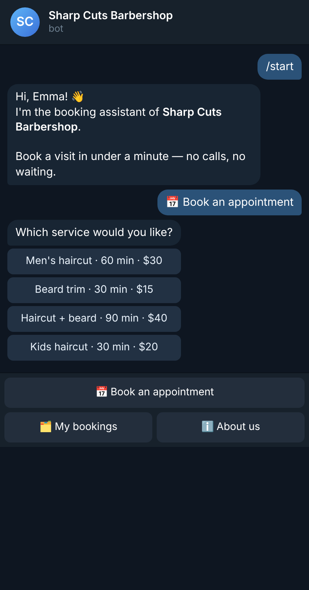
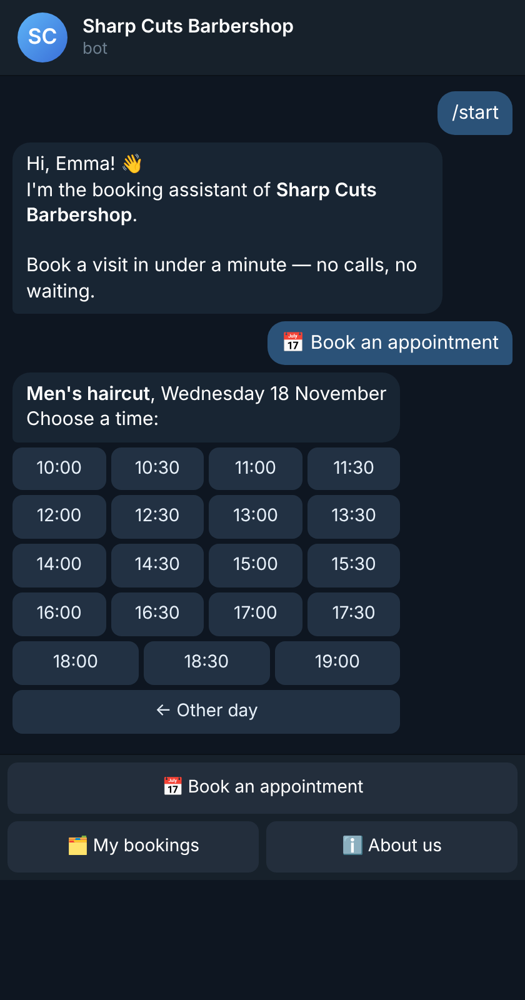
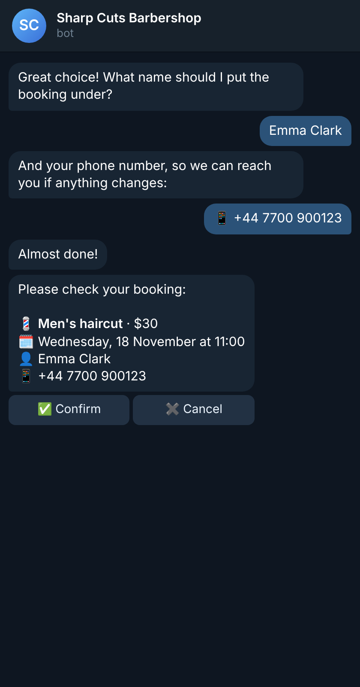
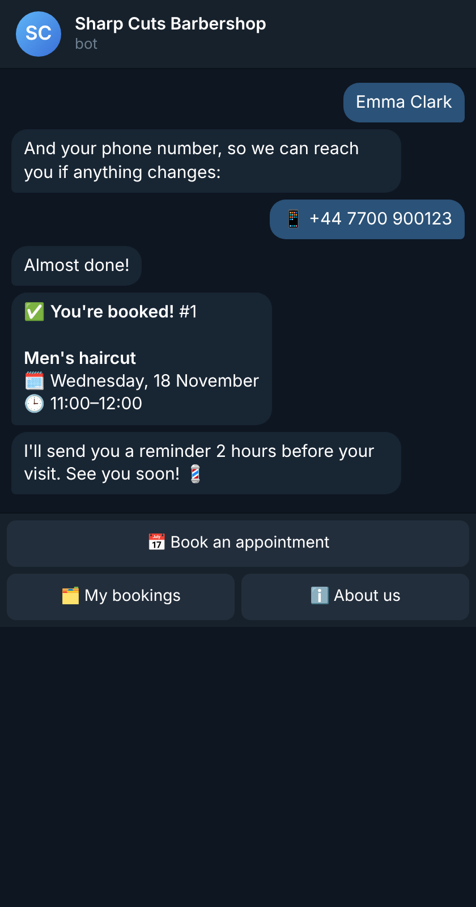
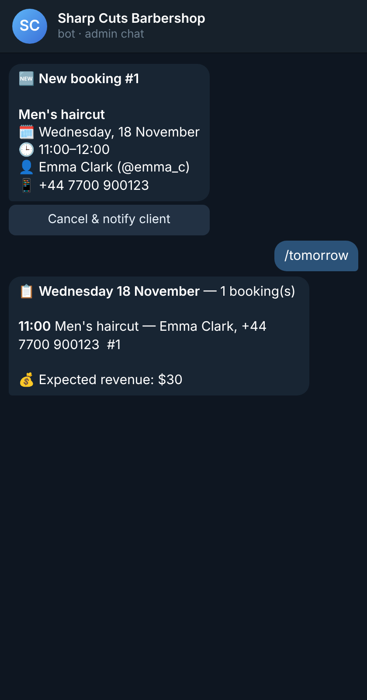
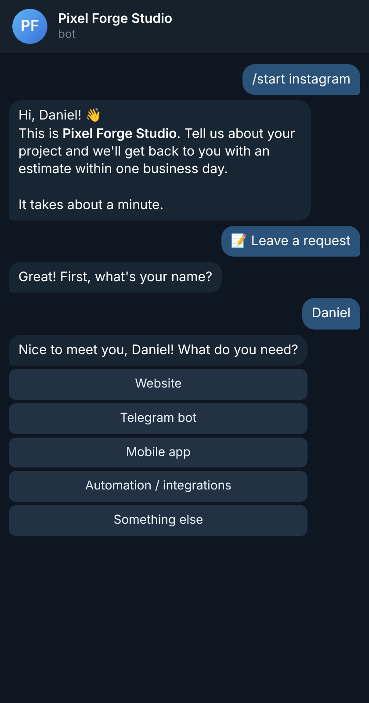
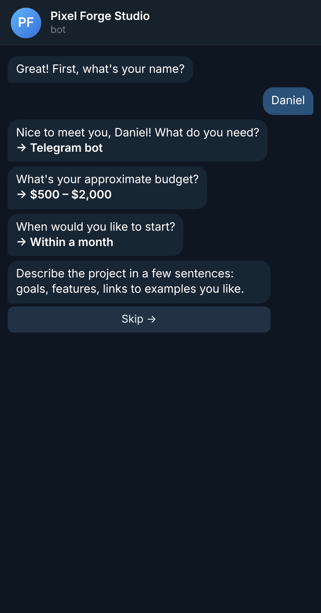
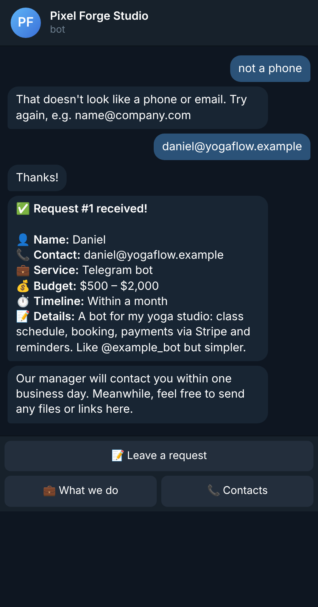
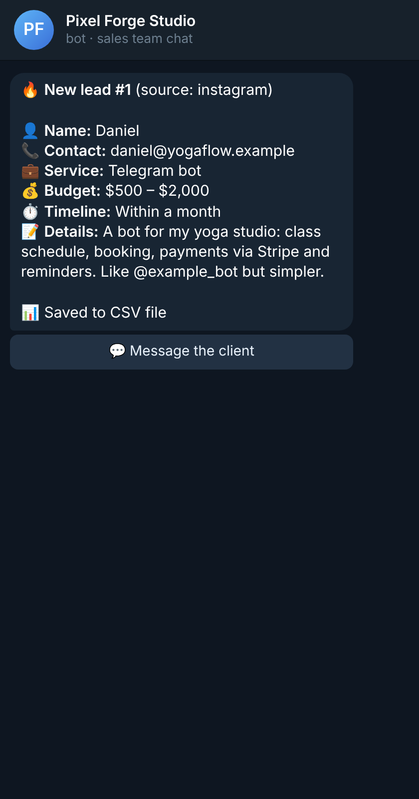

# Telegram Bots Portfolio

Three production-style Telegram bots that cover the most common small-business requests:
taking bookings, capturing leads, and answering customers with AI. Each one is a complete,
deployable project — not a snippet — with clean structure, configuration through `.env`,
Docker, and end-to-end tests.

| Bot | What it does for the business | Key tech |
|---|---|---|
| [**Booking bot**](booking-bot/) | Clients book a service and time slot in a few taps; the owner gets every booking instantly and a daily schedule; clients get reminders. | aiogram 3 FSM, SQLite, background reminders |
| [**Leads bot**](leads-bot/) | Replaces a website form: qualifies the lead (service, budget, timeline), saves it to **Google Sheets** and pings the sales team. | aiogram 3, gspread, deep-link source tracking |
| [**AI support bot**](ai-support-bot/) | Answers customer questions 24/7 from the company's knowledge base and hands tricky cases to a human operator. | Gemini (free tier), local LLM via Ollama, or Claude; human hand-off |

## Screenshots

### Booking bot
| Choose a service | Pick a time | Review | Booked | Owner's chat |
|---|---|---|---|---|
|  |  |  |  |  |

### Leads bot
| Start the request | Qualify | Sent | Sales team gets the lead |
|---|---|---|---|
|  |  |  |  |

Screenshots are generated from real runs of the bots' code: each scenario in [`demo/`](demo/) drives
the actual aiogram handlers through an offline Telegram emulator and renders the resulting chat.

## Stack

- **Python 3.12**, **aiogram 3** (async, FSM, callback data factories, routers, dependency injection)
- **SQLite** (aiosqlite) for bookings, **Google Sheets** (gspread) or CSV for leads
- **Gemini**, **Ollama** (local models) or the **Claude API** for the AI assistant, switchable in `.env`
- **Docker** / docker compose for deployment on any VPS

## Quick start

```bash
cd booking-bot                # or leads-bot / ai-support-bot
cp .env.example .env          # put your bot token from @BotFather and your Telegram ID
pip install -r requirements.txt
python -m app.main
```

Or run all three with Docker:

```bash
docker compose up -d --build
```

## Tests

Every bot has an end-to-end scenario that sends real updates (messages, button taps, shared contacts)
through its dispatcher and asserts on what the bot replies — no Telegram account or token needed:

```bash
pip install -r booking-bot/requirements.txt -r leads-bot/requirements.txt -r ai-support-bot/requirements.txt
python demo/scenario_booking.py
python demo/scenario_leads.py
python demo/scenario_ai.py
```

They cover the happy paths plus the details that break real bots: double-booking of a slot,
overlapping services, input validation, admin-only commands, operator replies, and chat history.

## Need a bot like this?

These are templates I adapt for clients: your services, texts, language, payments, CRM or
spreadsheet integration, admin panel, hosting and support. Contact me on Fiverr.

## License

MIT
