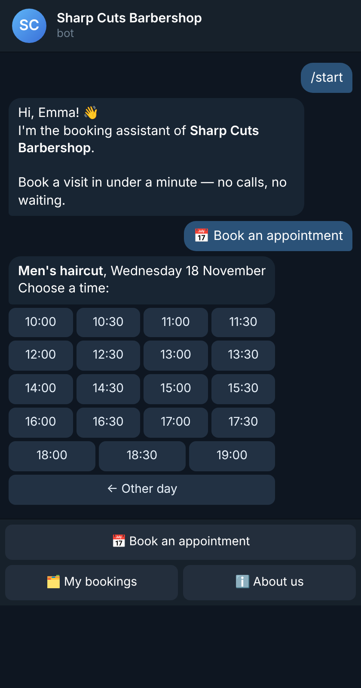

# Booking bot

A Telegram bot for appointment-based businesses: barbershops, beauty salons, clinics, tutors,
car services, photo studios. Clients book in a few taps, the owner sees everything in Telegram.



## Features

**For clients**
- Pick a service (with duration and price), a day and a free time slot from inline buttons
- Only truly free slots are shown: the bot accounts for service length and existing bookings
- Name and phone (one-tap "Share my phone number"), then a review step before confirming
- "My bookings" with one-tap cancellation
- Automatic reminder before the visit

**For the business owner**
- Instant notification for each new booking, with a "Cancel & notify client" button
- `/today`, `/tomorrow`, `/day YYYY-MM-DD` — schedule with expected revenue
- Notification when a client cancels
- Admin commands are visible only to admin IDs

**Under the hood**
- Race-condition check: the slot is re-validated at confirmation, so two clients can't take the same time
- Times stored in UTC, shown in the business time zone (DST-safe)
- No last-minute bookings (30 min buffer), configurable working hours, slot step and booking horizon

## Setup

1. Create a bot with [@BotFather](https://t.me/BotFather) and copy the token.
2. Find your Telegram user ID (e.g. via [@userinfobot](https://t.me/userinfobot)).
3. Configure and run:

```bash
cp .env.example .env   # fill in BOT_TOKEN and ADMIN_IDS
pip install -r requirements.txt
python -m app.main
```

Docker: `docker build -t booking-bot . && docker run -d --env-file .env -v $PWD/data:/bot/data booking-bot`

## Configuration

| Variable | Default | Meaning |
|---|---|---|
| `BOT_TOKEN` | — | Token from @BotFather |
| `ADMIN_IDS` | — | Comma-separated Telegram IDs that receive bookings and can use admin commands |
| `BUSINESS_NAME` | Sharp Cuts Barbershop | Shown in messages |
| `TIMEZONE` | Europe/London | Business time zone |
| `OPEN_HOUR` / `CLOSE_HOUR` | 10 / 20 | Working hours |
| `SLOT_STEP_MIN` | 30 | Distance between possible start times |
| `DAYS_AHEAD` | 7 | How many days ahead clients can book |
| `REMINDER_HOURS` | 2 | When to send the reminder |
| `DB_PATH` | data/bookings.db | SQLite file |

Services (name, duration, price) are defined in [`app/config.py`](app/config.py).

## Project structure

```
app/
├── main.py          # startup: bot, dispatcher, reminder task
├── config.py        # settings and the list of services
├── db.py            # SQLite storage
├── slots.py         # free-slot calculation
├── keyboards.py     # reply/inline keyboards and callback data
├── reminders.py     # background reminder loop
└── handlers/
    ├── client.py    # booking flow, my bookings, cancellation
    └── admin.py     # schedule commands
```

## Ideas for client versions

Several staff members with their own schedules, online prepayment (Telegram Payments / Stripe),
Google Calendar sync, a web admin panel, multiple languages, reviews after the visit.
