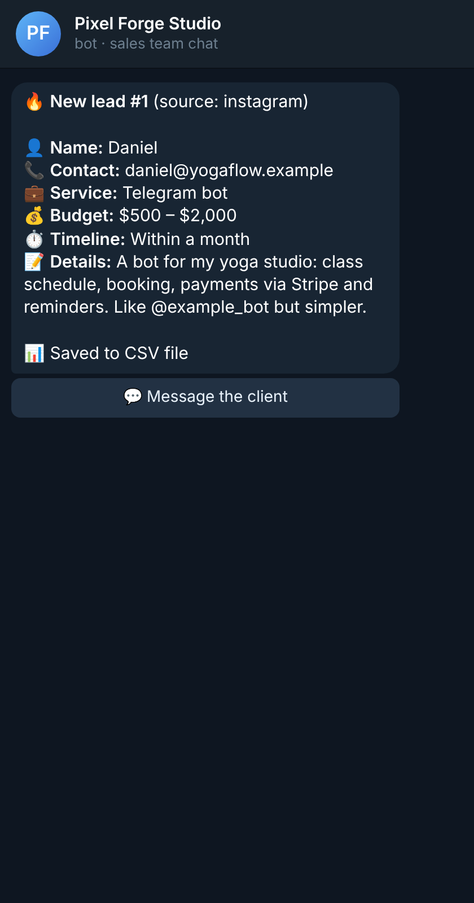

# Leads bot

A Telegram bot that replaces a contact form: it qualifies each request and drops it straight into
**Google Sheets**, while the sales team gets a notification in Telegram. Built for agencies,
freelancers, real estate, education, B2B services — anyone who sells through inquiries.



## Features

- Short guided form: name → service → budget → timeline → project details (optional) → contact
- One-tap phone sharing, or email/phone typed in, with validation
- Review step with "Send" / "Start over"
- Every lead is appended to a Google Sheet (header row, bold and frozen, created automatically)
  with a `Status` column the team can update
- Instant notification to managers and/or a team group, with a button to message the client
- **Source tracking**: links like `t.me/your_bot?start=instagram` record which ad or channel brought the lead
- Works without Google setup too: leads are saved to a CSV file
- Safe by default: user text is written to Sheets as raw values, never interpreted as formulas

## Setup

```bash
cp .env.example .env    # fill in BOT_TOKEN and ADMIN_IDS
pip install -r requirements.txt
python -m app.main      # leads go to data/leads.csv until Google Sheets is configured
```

### Connect Google Sheets

1. In [Google Cloud Console](https://console.cloud.google.com/) create a project and enable the
   **Google Sheets API**.
2. Create a **service account**, add a JSON key, save it as `credentials.json` next to `.env`.
3. Create a spreadsheet and share it (Editor) with the service account's email.
4. Put the spreadsheet ID (the long part of its URL) into `SPREADSHEET_ID` and restart.

> **Testing note:** the Google Sheets path (header creation, raw-value appends, lead numbering) is covered
> by `demo/scenario_leads.py` against a fake worksheet; the end-to-end demo and screenshots use CSV mode.
> Connect a real spreadsheet with the steps above before going live.

## Configuration

| Variable | Default | Meaning |
|---|---|---|
| `BOT_TOKEN` | — | Token from @BotFather |
| `ADMIN_IDS` | — | Telegram IDs that receive every lead |
| `LEADS_CHAT_ID` | — | Optional group for the sales team (add the bot to it) |
| `COMPANY_NAME` | Pixel Forge Studio | Shown in messages |
| `TIMEZONE` | UTC | For the lead timestamp |
| `GOOGLE_CREDENTIALS_FILE` | credentials.json | Service account key |
| `SPREADSHEET_ID` | — | Target spreadsheet; empty = CSV mode |
| `WORKSHEET_NAME` | Leads | Sheet tab (created if missing) |
| `CSV_PATH` | data/leads.csv | Fallback storage |

Form options (services, budgets, timelines) live in [`app/config.py`](app/config.py).

## Project structure

```
app/
├── main.py          # startup
├── config.py        # settings and form options
├── storage.py       # Google Sheets / CSV storage
├── keyboards.py     # keyboards and callback data
└── handlers/form.py # the lead form
```

## Ideas for client versions

CRM integration (HubSpot, Pipedrive, amoCRM, Notion), file uploads (briefs, photos), lead scoring,
automatic follow-ups, multi-language forms, a daily report to the owner.
